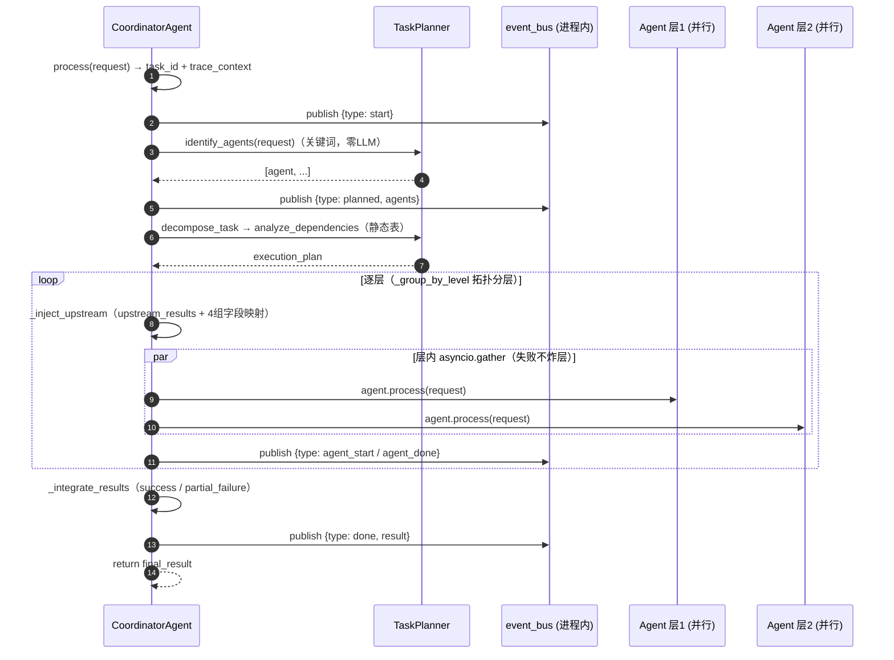
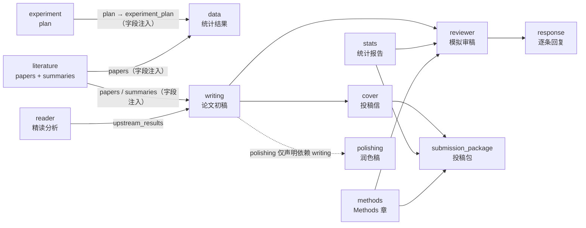
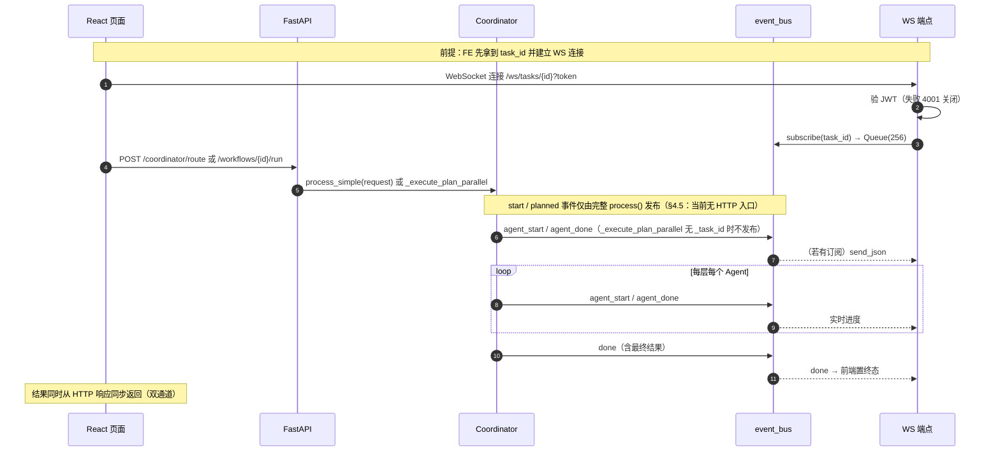

# 研究Agent平台 架构总览

> 生成日期：2026-08-27 · 基于 commit `8a5f014`（P2 清理、死代码删除与配置加固）
>
> 本文是系统的**实现级**架构文档：回答"是什么、怎么实现、数据怎么走"。
> 设计问题与风险清单不在此展开，见 `reports/project_full_audit_2026-08-23.md`（全面体检报告）；
> 第 10 章只列出"实现与 README 宣称有差距"的已核实事实，作为阅读前提。
>
> 文中 `文件:行号` 均指当前 commit 下的实际位置。

## 目录

1. [系统概览](#1-系统概览)
2. [后端架构](#2-后端架构)
3. [Agent 体系](#3-agent-体系)
4. [工作流深钻①：Coordinator 编排](#4-工作流深钻coordinator-编排)
5. [工作流深钻②：论文生产流水线](#5-工作流深钻论文生产流水线)
6. [进度与实时反馈](#6-进度与实时反馈)
7. [前端架构](#7-前端架构)
8. [昇腾工作台概览](#8-昇腾工作台概览)
9. [部署与运维](#9-部署与运维)
10. [实现与宣称的差距](#10-实现与宣称的差距)
11. [附录](#11-附录)

---

## 1. 系统概览

**定位**：高等教育科研效率提升的 AI Agent 平台。一个 FastAPI 后端 + React 18 前端，
内部包含**两个工作台**：

| 工作台 | 内容 | 实现形态 |
|---|---|---|
| **科研工作台** | 18 个 Agent 目录 = 16 个 LLM Agent（文献检索/精读/引用网络/数据分析/实验设计/写作/模拟审稿/审稿回复/投稿打包等）+ `figure`（纯绘图工具）+ `coordinator`（调度器） | `app/agents/*` 目录式 Agent + 静态依赖表驱动的 DAG 编排 |
| **昇腾工作台** | 本地化推理：NPU 环境检测、模型适配 10 步流程、精度对齐、性能采集/调优、工具链、验证、调试辅助 | `app/core/*.py` 功能模块（**不是** Agent），配 vLLM-Ascend 独立推理服务 |

两工作台共享同一套基础设施：LLM 客户端（remote/ascend 双模式）、缓存、限流、认证、计费、数据库。

**技术栈**

| 层 | 选型 |
|---|---|
| 后端 | Python 3.11 · FastAPI · SQLAlchemy 2 (async) · Alembic · Poetry |
| 数据库 | SQLite（开发默认）/ PostgreSQL 15（生产），`DATABASE_URL` 切换 |
| 缓存/限流 | 内存 或 Redis（ZSET+Lua 滑动窗口），双后端同接口 |
| 向量检索 | Milvus（可选，缺失时降级为不可用） |
| LLM | OpenAI 兼容 API（`openai` 异步客户端）或本地 vLLM-Ascend，`LLM_MODE` 切换 |
| 前端 | React 18.3 · TypeScript 5.6 · Vite 5 · Tailwind 3 · TanStack Query 5 · react-router 6 · vite-plugin-PWA · Capacitor 8（移动端壳） |
| 部署 | Docker（3 阶段构建）· docker-compose（remote/ascend 两套）· k8s 清单 |

**一句话数据流**：

```
前端页面 → /api/v1/* (JWT + 套餐限流) → [coordinator 关键词规划（零命中 LLM 兜底）]
→ 按静态依赖表拓扑分层 → 层内 asyncio.gather 并行执行 Agent
→ 上游结果字段级注入下游 → 汇总返回
（全程事件经进程内 event_bus → WebSocket → 前端进度条）
```

---

## 2. 后端架构

### 2.1 应用工厂与启动生命周期

入口 `app/main.py::create_app()`（`app/main.py:190`），`app = create_app()` 在模块底部实例化（L356）。

**启动顺序**（`lifespan`，`app/main.py:49-135`）——降级策略是贯穿全系统的设计模式：

| 顺序 | 组件 | 失败行为 |
|---|---|---|
| 1 | 昇腾 NPU 环境（仅 `LLM_MODE=ascend`）：`AscendNPUManager.check_environment()`，设置 `ASCEND_RT_VISIBLE_DEVICES` | **warn + 回退远程模式**（L56-79） |
| 2 | Redis 连接池（仅当 `CACHE_BACKEND=redis` 或 `RATE_LIMIT_BACKEND=redis` 时初始化，L95-102） | 运行期 get→None / 限流 fallback，不阻塞 |
| 3 | **数据库迁移**：`MIGRATION_ON_STARTUP=true` 时 `asyncio.to_thread` 跑 Alembic `upgrade head`（L110-118） | **拒绝启动**（fail-fast，无 `create_all` 兜底——体检报告 P1-9，避免两套 schema 漂移）；未启用迁移时才 `create_all`（L119-125） |
| 4 | Milvus 懒连接（L127-133） | warn，"向量检索不可用" |

**只有两件事能阻断启动**：DB 迁移失败、安全配置校验失败（`validate_security()` 强制生产环境非默认 `SECRET_KEY`、显式 CORS、Fernet 密钥）。其余组件全部优雅降级。

**关闭顺序**（L136-187）：Redis 连接池 → literature httpx 池 → vLLM/NPU embedding 客户端（ascend 模式）→ 用户级 OpenAI 客户端池 → Milvus。

**中间件与异常处理**（`create_app` 内）：

- **CORS**（L198-216）：`CORS_ORIGINS` 配置 + DEBUG 下自动补 5173/3000 本地 origin；`allow_credentials=True` 因此显式列 methods/headers（通配符会被浏览器拒绝）。
- **请求体上限**（L271-286）：`Content-Length > MAX_REQUEST_BODY_BYTES`（默认 2MB）直接 413，早于日志中间件。
- **请求日志**（L289-315）：复用/生成 `X-Request-ID`，用 `trace_context`（`app/core/tracing.py`，contextvars 实现 trace_id/span_id）包裹整个请求，所有日志自动带 trace。
- **异常处理三级**（L219-265）：
  1. `AppException`（业务基类）→ 按其 `status_code` 返回；
  2. `ValidationException` → 400；
  3. 兜底 handler 特判携带 `status_code` + `message` 属性的异常（如 `LibraryError` 家族）按声明状态码返回，否则 500（DEBUG 下泄漏前 500 字符细节）。

**路由挂载**（L318）：`api_router` 统一挂 `/api/v1`。
**SPA 托管**（L321-351）：`frontend/dist` 挂 `/static`；catch-all `GET /{full_path:path}` 返回 `index.html`，带 `is_relative_to` 路径穿越防护（`%2F..` 类编码攻击会被拒绝）；`dist` 不存在则跳过挂载并 warn。
**健康检查** `GET /health`（L359-431）：逐项探 DB（`SELECT 1`）/ Redis ping / Milvus `list_collections` / NPU+vLLM（ascend 模式），DB 或 Redis 挂则 `status=degraded`。

### 2.2 API 路由聚合

`app/api/v1/__init__.py` 按**领域**分 4 个域聚合：

| 域 | 路由数 | 前缀/内容 | 限流 |
|---|---|---|---|
| `research/` | 21 | `/literature /citation /reader /writing /polishing /stats /methods /figure /data /reviewer /response /review-loop /cover /submission-package /paper2ppt /paper-to-patent /experiment /data-availability /export /coordinator`（coordinator 含 4 端点：capability-map / workflow-templates / route / orchestrate） | **统一** `Depends(enforce_api_rate_limit)`（套餐限流，内含认证） |
| `library_domain/` | 1 | `/library`（收藏/分类/标签/引用/笔记/统计 6+ 子端点） | 认证 |
| `platform/` | 5 | `/auth /billing /agents`（AI 生成新 Agent）`/workflows`（用户 DAG）`/ws`（WebSocket） | 按端点 |
| `ascend_domain/` | 9 | `/ascend /adaptation /alignment /profiling /perf-tuning /toolchain /validator /history-to-skill /debugging` | 按端点 |

依赖注入统一在 `app/api/deps.py`：`get_current_user`（OAuth2 bearer → JWT 解码 → DB 查用户 + `is_active` 复查）、`enforce_api_rate_limit`。
除 `/health` 和注册/登录外**无公开端点**。

### 2.3 数据层

**数据库**（`app/core/database.py`）：`create_async_engine(DATABASE_URL, pool_pre_ping, pool_recycle=3600)`；`get_db()` 依赖注入 session，出错自动 rollback。默认 `sqlite+aiosqlite:///./research_agent.db`，生产 `postgresql+asyncpg://...`。

**模型**（`app/models/`）：

| 文件 | 模型 | 要点 |
|---|---|---|
| `user.py` | `User` | 角色 enum（admin/researcher/student/guest）；**个人 LLM 配置**：`api_key` 存 `EncryptedString`（Fernet）、`api_base_url`、`api_model` |
| `billing.py` | `UserAccount` / `UsageRecord` | 套餐（free/basic/pro/enterprise）、余额、已用调用/token 数 |
| `library.py` | `PaperCollection` / `PaperCategory` / `PaperTag` / `CitationRelation` / `ReadingNote` | 收藏（user+paper_id 唯一约束）、层级分类（`parent_id`）、标签、引用关系、阅读笔记 |
| `types.py` | `EncryptedString` | TypeDecorator，Fernet 静态加密；**缺 `API_KEY_ENCRYPTION_KEY` 时明文落库 + warn**（见第 10 章） |

**迁移**：`alembic.ini` + `migrations/`（async env.py，`render_as_batch=True` 兼容 SQLite），现存 2 个 revision（初始基线 + library 唯一约束）。

**服务层**（`app/services/`）：核心是 `library_service.py`（1040 行）统一 `LibraryService`，
由 6 个子服务组成——`PaperService`（收藏 CRUD + **tag.usage_count / category.paper_count 差分同步**）、
`CategoryService`（层级分类 + `_adjust_paper_count`）、`TagService`（`_adjust_usage`）、
`CitationService`（引用关系 + `_build_network` 构图 + 共引/影响力/脉络/前沿/聚类/时间线 7 种分析）、
`NoteService`、`LibraryStatsService`。

关键路径示例——`PaperService.add_paper`（`library_service.py:165-233`）：
业务层先查重（`PaperAlreadyExistsError`）→ 插入 + `flush`（拿 id 不提交）→ 同事务内调
`TagService._adjust_usage(delta=+1)` 和 `CategoryService._adjust_paper_count(delta=+1)` 同步计数 → 一次 `commit`。
并发场景由 DB 唯一约束兜底（捕获 `IntegrityError` 转 `PaperAlreadyExistsError`）。
`delete_paper`（L336-385）对称回收计数并**级联**删除阅读笔记与引用关系（citing/cited 任一匹配）。
注意其异常基类 `LibraryError` 不是 `AppException` 子类——靠 `main.py` 兜底 handler 的
`status_code` 属性约定映射到 HTTP 状态码。

其余服务：`auth.py`（注册/登录/锁定）、`citation_verification.py`（CrossRef/OpenAlex 实时引文核验）、
`citation_network.py`、`power_analysis.py`（实验功效）、`review_loop.py`（审稿-修改循环）、`statistics.py`。

### 2.4 核心基础设施（app/core/）

| 模块 | 职责 | 边界行为 |
|---|---|---|
| `cache.py` | `CacheBackend` ABC + 内存/Redis 两实现，`CACHE_BACKEND` 选择全局单例 `cache` | Redis 不可用时 get→None / set 静默（不抛错） |
| `rate_limit.py` | 内存滑动窗口 / Redis ZSET+Lua 分布式滑动窗口；`enforce_api_rate_limit` 按套餐 tier 限流 | `RATE_LIMIT_FALLBACK=allow|deny` 决定 Redis 挂时放行还是拒绝 |
| `security.py` | `python-jose` JWT HS256（access 30min + refresh 7d）、passlib bcrypt（>72B 密码 SHA-256 预哈希）、密码复杂度策略 | 必选组件 |
| `billing.py` | `PLANS` 套餐表（free=100 调用/10k tokens…enterprise 无限）；`check_quota` / `record_usage` | 依赖 DB |
| `vector_store.py` | pymilvus 封装，同步调用经 `asyncio.to_thread`，懒连接 + collection 缓存，SHA-256 ID，删除表达式注入防护 | `pymilvus` ImportError 容忍、连接失败非致命 |
| `ascend.py` | `AscendNPUManager`（torch_npu 环境探测/可见设备）、`VLLMAscendClient`（httpx 走 OpenAI 协议）、`NPULocalEmbedding` | 仅 ascend 模式启用；ImportError 降级 remote |
| `redis_client.py` | 连接池管理，`get_redis()` 挂时返回 None | 可选 |
| `events.py` | 进程内异步 pub/sub（详见第 6 章） | — |
| `tracing.py` | contextvars trace_id/span_id，`trace_context` / `span` | — |
| `workflows.py` | 用户自定义 Agent DAG（JSON 文件存 `data/workflows/`，路径注入防护） | 文件系统 |
| `agent_generator.py` | 自然语言 → 6 个产物（agent.py / manifest.yaml / API 路由 / React 页面 / api.ts 片段 / planner 条目） | 依赖 LLM |
| `adaptation.py` 等 9 个 | 昇腾工作台逻辑（见第 8 章） | ascend 向 |

> 注意：`docker-compose.yml` 曾含 `celery-worker` 死引用（引用不存在的 `app.core.queue`，celery 也非依赖），
> 2026-08-27 已移除（见第 10 章差距 #4）。

---

## 3. Agent 体系

### 3.1 BaseAgent：一个"薄抽象"，不是 Agent 框架

`app/agents/base.py`（177 行）定义 `BaseAgent(ABC)`。**先纠正一个常见预期：这里没有 ReAct / tool-calling 循环**——
Agent 不会"自主决定调哪个工具"。`process(request: dict) -> dict` 是抽象方法（L63），
每个 Agent 在自己的 `process` 里用**硬编码的 Python 流程**串起多步 LLM 调用与工具调用。
BaseAgent 提供的是五件基础设施：

| 能力 | 位置 | 行为 |
|---|---|---|
| 凭证解析 | `_resolve_credentials`（L32-47）/ `_resolve_model`（L18-30） | 优先级：**显式入参 > `AGENT_CREDENTIAL_OVERRIDES[agent]` > `AGENT_MODEL_OVERRIDES[agent]` > 全局**。三元组 `(api_key, base_url, model)` 整体解析，支持多团队/多供应商隔离 |
| Token 预算 | `_apply_token_budget`（L104-112） | `min(调用方 max_tokens, AGENT_TOKEN_BUDGETS[agent])`，单方缺省用另一方 |
| LLM 调用 | `call_llm`（L68-102）/ `call_llm_stream`（L114-146） | 自动套用上述解析与预算；异常统一包装 `AgentException`（带 agent 名） |
| 工具分发 | `use_tool`（L148-166）+ `_get_tool_handler`（L49-61） | 工具名 → 自身 `_tool_{name}` 方法，找不到再试 `self.tools_handler.{name}`；不在 `self.tools` 白名单内直接 `ToolException` |
| 请求校验 | `validate_request`（L168-173） | 缺必填字段 → `ValidationException` |

`__init__`（L12-16）只建 `self.llm = LLMClient()` 和 logger——**LLM 客户端每 Agent 一个实例**，
其内部的 OpenAI 连接池是复用的（见 3.2）。

### 3.2 LLMClient：统一调用链（app/utils/llm.py，396 行）

全系统**只有一个** LLM 入口。双模式由 `LLM_MODE` 决定：

- `remote`（默认）：`openai.AsyncOpenAI`，OpenAI 兼容协议，timeout 60s（L76-82）
- `ascend`：`VLLMAscendClient`（`app/core/ascend.py`，httpx 走 OpenAI 协议打到本地 vLLM-Ascend）

**调用链**：`generate()` → `generate_with_usage()`（L129-190），返回 `(text, usage)`：

```
generate_with_usage
├─ ① 缓存读（L149-167）
│    条件：use_cache AND temperature == 0 AND not user_api_key
│    键：hash(prompt + system + model + mode)
│    命中 → 直接返回，usage 全 0
├─ ② 路由（L174-184）：ascend 模式且无用户 key → _call_ascend；否则 _call_with_retry
├─ ③ 重试（L20-22）：MAX_RETRIES=3，首延迟 1.0s，指数退避 ×2
└─ ④ 缓存写（L187-188）：仅存文本（不存 usage），TTL=LLM_CACHE_TTL（默认 600s）
```

**客户端实例复用**（避免每请求新建 httpx 连接池）：

| 层 | 键 | 说明 |
|---|---|---|
| 系统级 | 单例 `self._remote_client` | 懒初始化，全进程共享 |
| 用户级 | `(sha256(api_key)[:32], base_url)` | 全局 dict 缓存（`_user_client_cache`），**上限 100**，满时持 `asyncio.Lock` 整体清空重建（L24-29, L61-75）；键用哈希而非明文，避免密钥长期驻留内存 |

注意缓存的两个边界（第 10 章会再提）：**`temperature != 0` 不缓存**（写作类 Agent 全用 0.0，所以写得进缓存）；
**用户自带 key 不缓存**（结果归用户所有，且不污染系统缓存）。

### 3.3 注册与发现：目录扫描，manifest 不参与运行时

`app/agents/registry.py`（94 行）的约定（模块 docstring，L1-10）：

- 每个 Agent = `app/agents/<name>/` 目录 + `agent.py` 里一个 `BaseAgent` 子类，**目录名即 agent 名**
- `coordinator` 不注册（它是调度器）
- `_scan_agents()`（L34-79）：遍历目录 → `importlib` 导入 → import 失败 **warn 并跳过**（单个 Agent 坏不影响整体）→ `inspect` 找模块内 `BaseAgent` 非抽象子类（要求 `__module__` 匹配，防止把 import 进来的基类误注册）
- `EXTRA_AGENTS`（L29-31）：`figure` 显式白名单注册——它**刻意不继承 BaseAgent**（纯 matplotlib，不调 LLM）
- `get_agent_registry()` 懒加载 + 全局缓存（L82-87）；`refresh_registry()` 供测试/热加载

**关键事实**：每个 Agent 目录里的 `manifest.yaml` 和 `SKILL.md` **没有任何 Python 代码解析**
（全 `app/` 目录零 `yaml` import）。它们的内容是面向 LLM 的协议描述——
`agent_generator`（AI 生成新 Agent 时作为模板参考）和 SKILL.md 的 LLM 路由协议会读，
但**运行时的 Agent 发现完全靠目录扫描**。README 中提到的 `manifest_router.py` 并不存在（第 10 章）。

### 3.4 Agent 总表（18 个）

任务列为 `CAPABILITY_MAP`（`planner.py:101-187`）声明的能力；依赖列为 `AGENT_DEPENDENCIES`
（`planner.py:278-286`），即 coordinator 编排时的上游。除已核实的 4 个（literature/writing/figure/coordinator，
见下文与第 4 章）外，其余 Agent 的 `process` 均为"硬编码多步 LLM 调用"形态，内部细节不逐一展开。

| Agent | 目录 | 声明任务 | 上游依赖 | 工具 | LLM 形态 |
|---|---|---|---|---|---|
| literature | `literature/` | search, summarize | —（根节点） | 6 个 → `LiteratureTools`（Semantic Scholar/arXiv httpx 检索、引用格式化） | **多步**：外部检索(无 LLM) + Semaphore 并发摘要 + LLM 综述（§3.5） |
| writing | `writing/` | draft, section, revise | literature, reader | `WritingTools`（论文类型分类学、大纲模板、术语账本） | **单发为主**，temp=0.0，类型学驱动（§3.6） |
| figure | `figure/` | generate, refine | — | **纯 matplotlib**（不继承 BaseAgent，无 LLM） | 不调 LLM；期刊导出规范 300dpi SVG/PDF/TIFF |
| reader | `reader/` | read, translate, annotate | — | — | 多步 LLM |
| citation | `citation/` | format, check, insert | — | — | LLM + CrossRef/OpenAlex 实时引文核验（`services/citation_verification.py`） |
| data | `data/` | analyze, visualize, upload, summary | experiment | `tools.py`（统计计算） | LLM + 本地统计 |
| data_agent | `data_agent/` | generate-statement, audit-statement, select-repository | — | — | LLM（数据可用性声明，FAIR 合规） |
| stats | `stats/` | audit, draft, check_test, check_multiple | — | — | LLM（统计报告合规审计） |
| methods | `methods/` | audit, draft, check_ethics, remove_vague | — | — | LLM（Methods 可复现性审计） |
| experiment | `experiment/` | design, optimize, predict | — | `tools.py`（功效分析等，另有 `services/power_analysis.py`） | LLM + 统计计算 |
| reviewer | `reviewer/` | review, score | writing, stats, methods | — | LLM（多角色模拟审稿） |
| response | `response/` | draft, point_by_point | reviewer | — | LLM（逐条审稿回复） |
| cover | `cover/` | draft, audit, presubmission | writing | — | LLM（投稿信 + desk-reject 审计） |
| submission_package | `submission_package/` | match_journal, checklist, consistency_check | cover, stats, methods | — | LLM（期刊匹配/清单/跨件一致性） |
| paper2ppt | `paper2ppt/` | convert | — | — | LLM |
| paper_to_patent | `paper_to_patent/` | convert | — | — | LLM |
| polishing | `polishing/` | polish, shorten, simplify | — | — | LLM（流式输出场景） |
| coordinator | `coordinator/` | （调度器，非业务） | — | 无 | **关键词路由零 LLM**；仅零命中时 LLM 兜底（§4.1） |

> 昇腾工作台的 9 个"Agent"（ascend/adaptation/alignment/...）**不在此表**——它们是
> `app/core/*.py` 功能模块，不是 `BaseAgent` 子类，不经 coordinator 调度（第 8 章）。

### 3.5 案例一：literature（最复杂 Agent，591 行）

为什么选它：唯一同时具备"外部数据源 + 工具层 + 并发 LLM + 下游注入源"四个特征的 Agent。

**构造**（L20-32）：声明 6 个工具白名单（`search_papers / extract_summary / format_citation /
manage_library / citation_network / reading_notes`），`self.tools_handler = LiteratureTools()`
——工具实现集中在 `tools.py`（独立 httpx 连接池，lifespan 关闭时统一 `close_http_client`）。

**process 是 task 分派器**（L34-53）：`search / read / summarize / library / citation_network / notes`
六分支，未知 task 抛 `AgentException`。注意这与 coordinator 的关键词路由是**两级分派**：
coordinator 决定"要不要来 literature"，`task` 字段决定"来干什么"。

**`_handle_search`（L55-80）——外部检索 + LLM 辅助的两段式**：

1. `tools_handler.search_papers(query, filters)` 打 Semantic Scholar/arXiv（**纯 HTTP，不耗 LLM**）；
2. 再发一次 LLM 调用（`temperature=0.0`），基于 query 生成 3-5 个建议关键词。
返回 `{papers, suggestions, total_results}`——`papers` 正是下游 writing/data 通过
`_inject_upstream` 拿到的字段（§4.3）。

**`_handle_summarize`（L100-170）——并发摘要的完整模式**，值得逐行看：

```python
# ① 预过滤：缺 title/abstract 的丢弃并记日志（L111-119）
# ② Semaphore 限并发（L122，_SUMMARIZE_CONCURRENCY = 5，模块级常量 L16）
sem = asyncio.Semaphore(_SUMMARIZE_CONCURRENCY)
async def summarize_one(paper):
    ...
    async with sem:
        summary = await self.call_llm(prompt, SUMMARIZE_SYSTEM_PROMPT, temperature=0.0)
    return {"title": ..., "summary": summary}

# ③ gather(return_exceptions=True)：单篇失败不影响整体（L135-137）
# ④ 过滤异常项；全失败才抛 AgentException（L140-150）
# ⑤ 第二次 LLM 调用：把所有单篇摘要拼成文献综述（L152-158）
```

两个设计点：所有 LLM 调用 `temperature=0.0` → 命中 LLMClient 缓存（同一批文献重复总结零成本）；
失败容忍到"篇"粒度而非整个任务。

**其余分支**：`_handle_library`（L172-247）委托 `LibraryService` 做收藏管理（搜索结果与文献库联动）；
`_handle_citation_network`（L249-337）+ `_dispatch_citation_analysis`（L339-449）分派 7 种引用网络分析
（图谱/共引/影响力/脉络/前沿/聚类/时间线，底层 `services/citation_network.py`）；`_handle_notes`（L451-520）阅读笔记。

### 3.6 案例二：writing（流水线核心，464 行）

为什么选它：被下游依赖最多（polishing/reviewer/cover 都声明它在上游）、且定义了系统的"确定性写作"约定。

**低温约定**（L30）：`_DETERMINISTIC_TEMPERATURE = 0.0`——"学术写作属半确定性任务，
低温保证结构与措辞可复现"。全 Agent 的 LLM 调用都用它 → writing 的输出**可被缓存**，
coordinator 重跑同一计划时文献→写作段可能零 LLM 成本。

**process 用分派表而非 if 链**（L49-51, L61-71）：

```python
self._task_handlers = {"outline": self.create_outline, "generate": self.generate_content, ...}
...
async def process(self, request):
    handler = self._task_handlers.get(request.get("task"))
    if handler:
        return await handler(request)
    raise AgentException(...)
```

**并发安全约定**（L63 注释）：用户级 API 配置（`_user_api_key/_user_api_base_url/_user_api_model`）
**通过 request dict 透传给 handler**，而不是存实例属性——因为 Agent 实例是进程级单例
（registry 懒加载后缓存），多请求并发共享，实例属性会互相污染。所有需要用户凭据的 handler 都遵守此约定。

**`create_outline`（L73-118）——"类型学驱动"的提示工程**：

1. `paper_type` 为 `auto` 时 `tools_handler.detect_paper_type(topic)` 推断（`WritingTools.PAPER_TYPES`
   是论文类型分类学：research/review/…，每种带 `definition / core_chain（核心论证链）/
   reader_question / drafting_order（推荐起草顺序）`）；
2. `create_outline_template(topic, paper_type, journal)` 生成结构化模板（工具，无 LLM）；
3. **一次** LLM 调用，prompt 把类型学信息（论证链、读者核心问题、起草顺序）+ 模板全部塞入，
   产出优化大纲。

**`generate_content`（L120-157）**：按大纲章节生成内容，若请求带 `terminology_ledger`（术语账本）
则注入 prompt 强制使用规范术语形式——这是跨章节术语一致性的实现手段。

**其余**：`polish`（L159-193，服务读者工作流不改论证结构）、`revise`（L195-241 +
`_parse_revise_result` 结构化解析修改指令）、`analyze_structure / build_terminology /
analyze_evidence`（L283-351）、`_handle_cite / _handle_export`（L353-392，多格式导出）、
`check_evidence_gaps / fix_latex_layout`（L432-464）。

**流水线位置**：上游经 `_inject_upstream` 收 `literature.papers / literature.summaries`
（若 reader 也在计划中，其结果也在 `upstream_results` 里）；下游 polishing/reviewer/cover
都以它为上游客（`AGENT_DEPENDENCIES`）。

---

## 4. 工作流深钻：Coordinator 编排

`CoordinatorAgent`（`app/agents/coordinator/agent.py`，350 行）+ `TaskPlanner`
（`planner.py`，380 行）是系统的调度核心。规划、分解、依赖分析全是**确定性代码**——
仅关键词零命中时才调 LLM 兜底选 Agent（temperature=0，命中结果缓存，§4.1）。
单例由 `app/agents/coordinator/__init__.py:10-13`
的 `@lru_cache get_coordinator_agent()` 提供，API 路由层在 import 时取走（`api/v1/coordinator.py:13`）。

### 4.1 规划阶段：三级关键词匹配 + 零命中 LLM 兜底

`TaskPlanner.identify_agents`（`planner.py:300-315`）按顺序尝试：

1. **精确匹配** `request["task"]`（lowercase 后查 `_keyword_index`）——命中即返回单 Agent；
2. **关键词扫描** `task` 字段：`_match_keywords`（L317-333）遍历 16 组 skill 的中/英文关键词表
   （`SKILL_KEYWORD_MAP`，L5-98），做子串匹配；
3. **兜底扫描** 整个 `str(request)`（含 content 等所有字段的 repr）。

`_match_keywords` 的**特异性去重**是关键词路由里唯一的"智能"：若命中的关键词 A 是另一个命中关键词 B
的真子串（如「数据」⊂「数据可用性」），A 对应的通用 Agent（`data`）被剔除，只保留 B（`data_agent`）。
这是为了修一个历史 bug：「数据可用性声明」曾同时路由到 `data`，后者收到 statement 任务后必然抛
"未知任务类型"（回归测试 `tests/unit/test_planner_registry_consistency.py` 锁定）。

**局限**：纯子串匹配，无词界、无否定处理——"不要分析数据"仍命中 `data`；
`SKILL_KEYWORD_MAP` 的 16 组关键词与注册表的一致性由上面的回归测试强制（任何新 Agent 必须同步补关键词表，
否则测试失败）。

**零命中 LLM 兜底**（2026-08-28 加，关闭第 10 章差距 #1）：三级匹配全零命中时，coordinator 不再静默空转——
`process()` 与 `process_simple()` 都改调 `_llm_route`（`agent.py:281-323`）：把 task + 截断到 500 字符的
content 与注册表能力清单（「名: 描述（tasks: …）」逐行）交给 LLM（`temperature=0`，命中 LLM 结果缓存），
从返回文本里提取 `{"agents": [...]}`，只保留注册表内的名字、未知名剔除并 warn；任何失败
（调用异常 / 无 JSON 花括号 / 非法 JSON）一律返回 `[]`，回退修复前行为
（`process()` 空成功、`process_simple()` 抛"未知任务类型"）。关键词命中路径**完全不受影响**——
零成本、零延迟，P1-7 回归原样不动。同期修剪了 paper2ppt 关键词组中的「报告」：
泛化的「请给一份报告」曾误路由 PPT，修剪后归零命中交 LLM 判定，
「转化成PPT演讲」等具体表述仍确定性命中。残余局限：否定处理仍缺失（"不要分析数据"仍命中 `data`）——
兜底只在零命中时触发，改不动已命中的路径。

### 4.2 分解与依赖：静态表，不是分析

- `decompose_task`（L355-361）：**每个命中 Agent 一个子任务，请求原样共享**（同一 request dict 被引用进所有子任务）；
- `analyze_dependencies`（L363-371）：查 `AGENT_DEPENDENCIES`（L278-286）7 条静态依赖：

```python
AGENT_DEPENDENCIES = {
    "writing": ["literature", "reader"],
    "data": ["experiment"],
    "polishing": ["writing"],
    "reviewer": ["writing", "stats", "methods"],
    "cover": ["writing"],
    "submission_package": ["cover", "stats", "methods"],
    "response": ["reviewer"],
}
```

不在表里的 Agent 依赖为空（视为可最先执行）。**注意这是偏序不是全序**：`stats`/`methods`/`experiment`
自身无依赖，即使语义上应在写作之后，它们也会和 `literature` 同层并行（见 §5.3 示例）。

### 4.3 并行调度：拓扑分层 + 层内 gather

`_execute_plan_parallel`（`agent.py:93-138`）：

1. `_group_by_level`（L178-207）：Kahn 式逐层取"依赖已全部完成的子任务"。
   **闭包问题已修复（2026-08-27）**：此前若某 Agent 的依赖不在本次计划中（如用户只说
   "写论文"只命中 `writing`，`literature`/`reader` 缺失），该 Agent 永远进不了任何层，
   循环检测分支误报"循环依赖"（实测必抛）。现在 `process()` 在 `identify_agents` 之后先调
   `TaskPlanner.complete_upstream`（planner.py，对 `AGENT_DEPENDENCIES` 求传递闭包）把缺失
   上游补进计划再分层——"写论文"自动扩展为 `literature + reader + writing`（回归测试
   `tests/unit/test_planner_complete_upstream.py`）。`_group_by_level` 的循环检测保留为
   真正循环依赖的安全网；`process_simple`（单 Agent 语义）刻意不补全。
2. 逐层执行：层内 `asyncio.gather(*tasks, return_exceptions=True)`（L119）——**单任务失败不炸整层**，
   记为 `{"status": "failed"}` 继续；只有成功的结果进入 `context`（L115-116, L134-135），
   下游注入时自然拿不到失败 Agent 的产物。
3. 层内只有 1 个任务时走顺序分支（L110-116），不走 gather。
4. 每个子任务经 `_execute_single_task`（L209-247）执行：`get_agent` 懒加载实例
   （缓存在 `self._agent_instances`）→ `span(agent_name)` 包裹（trace 计时）→ 发布
   `agent_start`/`agent_done` 事件（仅当子任务携带 `_task_id` 时）。

### 4.4 上游结果注入：`_inject_upstream`（L150-181）

两层注入：

| 层 | 机制 | 内容 |
|---|---|---|
| 通用 | `request["upstream_results"] = {dep: 上游完整结果}` | 依赖表声明的所有成功上游 |
| **声明式字段映射** | `UPSTREAM_FIELD_MAP`（`planner.py`，4 组表项） | `literature.papers → writing.papers`；`literature.summaries → writing.summaries`；`literature.papers → data.papers`；`experiment.plan → data.experiment_plan` |

字段映射只在目标字段**尚未存在**时填充（`request.get(field)` 为空才写入），
即调用方显式传入优先于上游注入。映射是声明式表
`{下游 agent: {目标字段: (上游 agent, 源字段)}}`（~~原为写死的 if 链~~，2026-08-28 重构，
差距 #3）——新增"文献→写作"式数据流只需在表里加一行，不动 coordinator 代码。
契约由 `tests/unit/test_upstream_injection.py`（10 用例）锁定，含
表↔注册表一致性检查（P1-7 式，防拼写漂移）。

### 4.5 汇总与两条对外路径

`_integrate_results`（L244-264）输出 `{agents_used, results, status, failed_agents}`，
任一失败则 `status="partial_failure"`（不抛错）。

**对外入口（关键事实）**：

| 入口 | 调用 | 编排行为 | 事件推送 |
|---|---|---|---|
| `POST /coordinator/route`（`api/v1/coordinator.py:51-62`） | `process_simple`（L271-285） | **单 Agent**：取 `identify_agents` 第一个结果直接执行，不做分解/依赖/并行/补全 | 无 |
| `POST /coordinator/orchestrate`（`api/v1/coordinator.py:65-86`，2026-08-27 新增） | **完整 `process()`**（L49-91）：规划→上游补全→分解→依赖→并行→注入→汇总 | 关键词规划的多 Agent 并行；`task_id` 可传入（前端先建 WS 再发请求） | **有**（start/planned/agent_start/agent_done/done） |
| `POST /workflows/{id}/run`（`api/v1/workflows.py:93-116`） | 直调 `_execute_plan_parallel` + `_integrate_results` | 用户自定义 DAG（显式 edges，无静态表），执行前注入用户 API 配置 | 无（plan 未注入 `_task_id`） |

历史备注（2026-08-27 修复前）：完整编排 `process()` 曾**没有任何 HTTP 端点调用**，只被
集成测试触达，README 宣传的"多 Agent 并行 + 实时事件流"主链路在 HTTP 层休眠（第 10 章
差距 #8）。现已由 `/coordinator/orchestrate` 接通，前端 Coordinator 页"多 Agent 编排"
tab 走 先连 WS → 再发请求 的双通道模式（§6.3）。

`GET /coordinator/capability-map` 与 `GET /coordinator/workflow-templates` 只返回
`CAPABILITY_MAP` / `WORKFLOW_TEMPLATES` 静态数据（`api/v1/coordinator.py:25-34`），供前端展示能力清单。

### 4.6 编排时序（设计意图）



---

## 5. 工作流深钻：论文生产流水线

科研工作台的价值主张是"一条指令走完论文生产"。这条流水线由三部分拼成：
**静态依赖表**（§4.2 的 `AGENT_DEPENDENCIES`）决定先后，**字段注入**（§4.4）决定数据怎么流，
**`WORKFLOW_TEMPLATES`**（`planner.py:190-275`）给出 4 条人工编排的标准剧本
（`write_from_scratch` 12 步 / `submit` 5 步 / `revise` 5 步 / `transform` 2 步），
后者仅供 `GET /coordinator/workflow-templates` 展示——**它不驱动任何自动执行**。

### 5.1 数据流：谁给谁传什么



只有虚线外的 4 组箭头有**字段级**注入；其余依赖关系只产生"顺序 + `upstream_results`
整体可见"，下游 Agent 是否真的读 `upstream_results` 取决于其 `process` 实现
（`writing` 当前读的是被注入的 `papers`/`summaries` 字段，而非 `upstream_results` 键）。

### 5.2 一次完整编排的层级推演

以"写论文、模拟审稿"为例（闭包修复后无需把上游说全：`identify_agents` 命中
`writing + reviewer`，`complete_upstream` 自动补出 `literature/reader/stats/methods`）：

| 层 | 并行执行 | 说明 |
|---|---|---|
| L1 | literature ∥ reader ∥ stats ∥ methods | 无依赖；literature 先打 Semantic Scholar/arXiv 再 LLM 摘要 |
| L2 | writing | 收 `papers`/`summaries` 注入，temp=0.0 生成（可命中 LLM 缓存） |
| L3 | reviewer | 读 `upstream_results[writing]` 做模拟审稿 |

注意 `stats`/`methods` 与 literature **同在 L1 并行**（它们无上游声明）——
依赖表表达的是"审稿需要三者"而非"统计需要写作完成"，这是当前模型的表达力边界。

### 5.3 投稿与修稿两条支线

- **投稿**（`submit` 模板）：submission_package(期刊匹配) → cover(投稿信) →
  submission_package(清单) → submission_package(跨件一致性) → cover(desk-reject 审计)。
  依赖表保证 `cover` 晚于 `writing`、`submission_package` 晚于 `cover/stats/methods`。
- **修稿**（`revise` 模板）：reader(读审稿意见) → response(逐条回复) → writing(修改) →
  polishing(润色) → reviewer(自审确认)。对应 `AGENT_DEPENDENCIES` 的
  `response → reviewer`、`writing → polishing` 链条。
- **用户自定义**：前端 WorkflowEditor 画的任意 DAG 经 `POST /workflows/{id}/run` 执行，
  `workflow_to_execution_plan`（`app/core/workflows.py:155-245`）做自环/循环（DFS 三色）/
  重复 agent 名三重校验后复用同一个 `_execute_plan_parallel` 引擎——用户 DAG 没有静态表，
  因此**不存在闭包问题**（实测：data 的静态上游 experiment 不在图中也正常执行），
  但也没有事件推送（实测确认，§4.5）。
  注意：三重校验中"重复 agent 名"分支曾有一处缺陷（f-string 后误带 `(`，触发时抛
  `TypeError` 而非设计的 `ValueError`），2026-08-27 已修复并加回归测试
  `tests/unit/test_workflow_dag_validation.py`（见第 10 章差距 #9）。

---

## 6. 进度与实时反馈

### 6.1 事件总线：进程内 pub/sub（app/core/events.py，76 行）

`TaskEventBus` 全局单例 `event_bus`：`task_id → list[asyncio.Queue(maxsize=256)]`。
`publish`（L39-53）向该 task 的所有订阅者队列 `put_nowait`，**队列满则丢弃该事件并踢掉
这个慢订阅者**（不阻塞发布者，也不阻塞其他订阅者）；`subscribe/unsubscribe` 管理队列，
最后一个订阅者离开时清理整个 task 条目。**无持久化、无重放**——连接建立前发生的事件
（如 `start`/`planned`）订阅者收不到，这是前端偶发"进度从头缺失"的结构性原因。

### 6.2 WebSocket 端点（app/api/v1/ws.py，65 行）

`WS /api/v1/ws/tasks/{task_id}?token=<JWT>`：

1. 先验 token（`decode_access_token`），失败以 4001 关闭，**accept 之前**完成认证；
2. accept 后 `event_bus.subscribe(task_id)`，双任务并发：`send_events`（队列 → `send_json`）
   与 `recv_keepalive`（吞掉客户端 ping / 感知断开），`asyncio.gather` 任一结束即拆；
3. `finally` 中 `unsubscribe`，保证连接泄漏安全。

### 6.3 前端消费（frontend/src/hooks/useTaskStream.ts）

`useTaskStream(taskId, enabled, onOpen?)`：按 `location.protocol` 选 ws/wss 拼
`/api/v1/ws/tasks/{taskId}?token=`，`onmessage` 累积 `events`、`planned` 事件填
`plannedAgents`（计划步骤清单）、按 `agent_start/agent_done` 维护 `agents` 进度、
`done` 置终态；`onOpen` 回调在连接建立时触发（2026-08-27 增加）。

页面侧 Coordinator.tsx 的"多 Agent 编排"tab（2026-08-27 新增）是事件流链路的
首个完整消费者：前端生成 `taskId`（`crypto.randomUUID`）→ 设给 hook 建 WS 连接 →
`onOpen` 触发后（或 800ms 兜底超时后）才调 `coordinatorApi.orchestrate(task, '', taskId)`
→ 后端事件从 `start` 起全部可被收到，进度条按计划步骤实时点亮；最终结果同时经
HTTP 响应返回（双通道）。此前该页只用 route/capabilityMap/workflowTemplates 三个
HTTP 接口，WS 链路虽完整但无触发者（§4.5）。

### 6.4 全链路图



---

## 7. 前端架构（链路级）

`frontend/`：React 18.3 + TypeScript 5.6 + Vite 5 + Tailwind 3 + react-router 6 + TanStack Query 5（staleTime 5s / retry 2）+ vite-plugin-PWA + Capacitor 8（移动端壳）。约 39 个页面，`App.tsx` 内全部 `React.lazy` 按路由分包。

**与后端的四条链路**：

1. **HTTP 请求封装**（`src/api.ts`，887 行）：单一 `request()` fetch 包装器，`API_BASE='/api/v1'`，
   自动附加 `Authorization: Bearer`，按域导出 `coordinatorApi / literatureApi / ...` 等 API 对象。
   开发态 Vite 代理 `/api → localhost:8000`；生产态由 FastAPI 直接托管（`base:'/static/'`，§2.1 SPA 路由）。
2. **认证**（`src/auth.tsx` + `App.tsx`）：`AuthContext` 管理会话；`RequireAuth` 守卫包住整个
   `/app` 路由树（`App.tsx:76-108`），`/login` 反向用 `RedirectIfAuth`。Token 存储刻意
   **内存优先 + sessionStorage**（不用 localStorage，防 XSS 持久窃取，`api.ts:30-48`）；
   access token 过期 401 时 `refreshAccessToken()` 用长效 refresh token 换新，失败才清会话（`api.ts:104-110`），
   与后端 access 30min / refresh 7d 的 JWT 双令牌对应（§2.3）。
3. **实时进度**：`useTaskStream`（§6.3）。
4. **离线**：PWA 对 `/api/v1/*` 用 NetworkFirst 策略缓存，配合离线 manifest。

**页面组织**：`/`（Hero）与 `/login` 在守卫外；`/app/*` 下按工作台分组——科研（coordinator、
audit、literature、reader、library、network、citation、data、writing、reviewer、response、
review-loop、experiment、export、figure、paper2ppt、paper-to-patent、cover、methods、
submission-package、polishing、stats、data-availability、profile）与 `ascend/*`（9 个昇腾页面），
另有 AgentGenerator、WorkflowEditor 两个平台页。组件层（`src/components/`）含 Layout、
ErrorBoundary、CommandPalette、Dock 等约 14 个。

**已知口径**：页面大多"一页对一个后端域"，逐页面映射表信息密度低，本文不展开；
Coordinator 页当前仅消费单 Agent 路由与静态能力表（§4.5/§6.3）。

---

## 8. 昇腾工作台概览

与科研 Agent 体系**形态完全不同**：9 个模块全是 `app/core/*.py` 功能模块（合计 9363 行），
不是 `BaseAgent` 子类，不注册、不经 coordinator 调度；各自有独立 API 路由
（`app/api/v1/ascend_domain/__init__.py`：`/ascend /adaptation /alignment /profiling /perf-tuning
/toolchain /validator /history-to-skill /debugging`）和前端 `ascend/*` 页面。

| 模块 | 行数 | 职责 |
|---|---|---|
| `ascend.py` | 420 | 基础设施三件套：`AscendNPUManager`（torch_npu/CANN 环境探测、可见设备设置）、`VLLMAscendClient`（httpx 走 OpenAI 协议 → vLLM-Ascend）、`NPULocalEmbedding`（NPU 本地 bge embedding） |
| `adaptation.py` | 1700 | **10 步模型适配 playbook**（§8.1） |
| `alignment.py` | 327 | 远程 vs 本地推理精度对齐验证 |
| `profiling.py` | 886 | NPU 性能数据采集 |
| `perf_tuning.py` | 1474 | 推理性能参数调优（task queue / CPU affinity / tcmalloc 等） |
| `toolchain.py` | 981 | vLLM-Ascend 工具链集成 |
| `validator.py` | 1114 | 模型推理质量验证 |
| `debugging.py` | 1163 | NPU 推理调试辅助 |
| `history_to_skill.py` | 1298 | 历史记录 → 可复用 SKILL.md |

运行模式由环境变量控制：`LLM_MODE=ascend`（LLM 走本地 vLLM）、`EMBEDDING_MODE=ascend_api|ascend_local`；
启动期 NPU 探测失败自动回退远程（§2.1），因此昇腾组件整体也是**可选件**。

### 8.1 10 步适配流程（adaptation.py:1624-1685）

把一个 HF/本地模型适配到 vLLM-Ascend 的固定 playbook（"adapt-agent 10 步"）：

| 步 | 名称 | 关键点 |
|---|---|---|
| 1 | 收集上下文 | 模型路径、实现根目录、交付仓库、默认功能集 |
| 2 | 分析模型 | 读 `config.json`，推断架构类型/注意力变体/量化类型 |
| 3 | 算子兼容性门控 | 扫描算子分类 Torch/Triton/CUDA；**CUDA 无 fallback → BLOCKED**（唯一阻断点） |
| 4 | 框架侧代码分析 | 检查 vLLM registry 与 vllm-ascend 补丁 |
| 5 | 选择适配策略 | reuse / patch / new_adapter / blocked |
| 6 | 实现最小代码改动 | 生成 adapter / weight_loader / registry 代码模板 |
| 7 | 两阶段验证 | 7a `--load-format dummy` → 7b 实际权重 |
| 8 | 验证推理和功能 | 生成 curl 测试命令 + 功能检查 |
| 9 | 生成产物 | YAML 配置、文档、提交命令 |
| 10 | 交接产物 | 汇总交接报告 `handoff_report` |

多数步骤是 LLM 辅助的代码分析/生成 + 本地状态推进，与科研 Agent 的"LLM 为主"正好互补。
配套 `Dockerfile.ascend` / `docker-compose.ascend.yml` 提供独立推理栈（§9）。

---

## 9. 部署与运维

**镜像**（`Dockerfile`，3 阶段）：node:20 构建前端 → python:3.11-slim + Poetry 装依赖 →
最终镜像拷入 `frontend/dist`；非 root `appuser`；`uvicorn app.main:app --workers 4`；
`/health` 作 healthcheck。`Dockerfile.ascend` 为 NPU 变体。

**两套 compose**：

| | `docker-compose.yml`（remote） | `docker-compose.ascend.yml` |
|---|---|---|
| 推理 | 无（走远程 API） | `vllm-ascend`（Qwen2.5-72B-Instruct, TP4）+ `vllm-embedding`（bge-large-zh-v1.5） |
| 应用 | `api` | `research-agent`（`LLM_MODE=ascend`） |
| 数据 | `db`（postgres:15-alpine）、`redis:7-alpine`、`milvus`（standalone） | 同左 + `etcd:3.5.5`、`minio`、`milvus:2.3.3` + 5 个 named volume |
| 其他 | `nginx`（production profile） | — |

**运维要点**：

- 迁移策略由 `MIGRATION_ON_STARTUP` 控制：开 → 启动即 Alembic `upgrade head`（失败拒绝启动）；
  关 → `create_all`（开发态）。生产建议常开。
- `/health` 分组件报告（DB/Redis/Milvus/NPU），DB 或 Redis 挂 → `status=degraded`，可接 LB 探活。
- `nginx/nginx.conf` 提供生产反代；`k8s/` 目录**当前为空**（占位）。
- `Makefile` 聚合 run / docker-up / docker-ps / docker-logs / test 等日常命令。
- 工作流 JSON 落 `data/workflows/`、日志落 `logs/`、上传落 `uploads/`——均为容器外挂载点。

---

## 10. 实现与宣称的差距

本章只列**已核实**的"README/宣传与实际实现不一致，或易被误读"的事实，作为阅读前提。
每条给出代码证据；设计层面的问题与修复建议不在此重复，见
`reports/project_full_audit_2026-08-23.md`（体检报告）及 `docs/review/`。

| # | 差距 | 代码证据 | 影响 |
|---|---|---|---|
| 1 | **"智能路由/coordinator"实为关键词匹配 + 静态依赖表**（~~规划环节零 LLM~~：2026-08-28 零命中 LLM 兜底已加） | `planner.py:5-98`（`SKILL_KEYWORD_MAP`）、`planner.py:278-286`（`AGENT_DEPENDENCIES`）；兜底 `_llm_route`（`agent.py:281-323`，temperature=0 + 结果缓存，失败回退零命中行为）；paper2ppt 组移除「报告」关键词（修「请给一份报告」误路由） | 关键词命中路径保持确定性（P1-7 回归不动）；LLM 兜底仅零命中触发，补上关键词表覆盖缺口；"不要分析数据"类否定表述仍误路由（兜底管不到已命中路径）。回归测试 `tests/unit/test_llm_route_fallback.py`（11 用例）锁定兜底接线与解析回退 |
| 2 | **README 提到的 `manifest_router.py` 不存在**；各 Agent 目录的 `manifest.yaml`/`SKILL.md` 无任何程序解析 | 全 `app/` 435 个文件零 `yaml` import（2026-08-27 实测）；Agent 发现纯靠 `registry.py:34-79` 目录扫描 | manifest 是面向 LLM/文档的声明，不是运行时配置——改 manifest 不影响行为 |
| 3 | **"Agent 间结果传递"是字段映射而非语义级传递**（~~4 组硬编码 if~~：2026-08-28 已提为声明式映射表） | `UPSTREAM_FIELD_MAP`（`planner.py`，`{下游: {目标字段: (上游, 源字段)}}`）+ `_inject_upstream`（`agent.py:150-181`）声明式遍历；行为不变（显式传入优先、只补缺失字段） | 新增数据流 = 表里加一行（不再改 coordinator 代码）；仍非语义级（下游靠字段约定读上游产物，`upstream_results` 整体可见但多数下游不读）。契约测试 `tests/unit/test_upstream_injection.py`（10 用例，含表↔注册表一致性） |
| 4 | **~~compose `celery-worker` 是死引用~~（已移除，2026-08-27）**：`celery -A app.core.queue worker`，而 `app/core/queue.py` 不存在、celery 非依赖（requirements/pyproject 亦无 celery） | 原 `docker-compose.yml:40-56`，整段删除 | 顺带修正 `app/api/v1/__init__.py` docstring 的 research 路由数 19→20 |
| 5 | **LLM 结果缓存范围很窄**：仅 `temperature==0` 且**系统凭据**调用 | `app/utils/llm.py:149,187`（`if use_cache and temperature == 0 and not user_api_key`） | 用户自带 key 不缓存（结果隔离，有意为之）；非零温度（如 literature 的关键词建议用 0.0 可缓存，但默认 `call_llm` 温度 0.7 不缓存） |
| 6 | **`EncryptedString` 缺 Fernet 密钥时明文落库**，仅 warn 不报错（~~生产防线不完整~~：2026-08-28 畸形密钥 fail-fast 已加） | `app/models/types.py:32-34`（明文降级点）；`config.py::validate_security` 现强制非 DEBUG 下密钥非空**且**为有效 Fernet 密钥（`Fernet(key.encode())` 构造失败即拒绝启动），堵住「配置了但写错」绕过空检查的缺口 | 生产环境两种明文落库路径（空密钥/畸形密钥）均已 fail-fast；开发态（DEBUG）明文降级仍为已知行为，仅 warn。回归测试 `tests/unit/test_config_fernet_key.py`（5 用例） |
| 7 | **空目录占位**：`docs/api/`、`docs/architecture/`（本文档是首份）、`docs/deployment/`、`tests/integration/api/`、`tests/e2e/`、`tests/performance/`、`k8s/` | 目录实测 | 文档/测试矩阵名大于实：45 个测试文件 = 44 单测（`tests/unit/`）+ 1 集成（`tests/integration/`），e2e/performance 为空 |
| 8 | **~~完整编排 `CoordinatorAgent.process()` 无 HTTP 入口~~（已修复，2026-08-27）**：`/coordinator/route` 只走 `process_simple`，`/workflows/{id}/run` 直调 `_execute_plan_parallel` 且不发事件，`process()` 曾仅被集成测试触达 | 新增 `POST /coordinator/orchestrate`（`api/v1/coordinator.py:65-86`，透传 `_task_id` + 用户凭据）+ 前端 Coordinator 页编排 tab（先连 WS 再发请求）；E1 认证用例已覆盖新端点 | README 宣称的主链路现已端到端接通：编排 → 事件 → WS → 前端进度条 |
| 9 | **~~`workflow_to_execution_plan` 的"重复 agent 名"校验分支自身崩溃~~（已修复，2026-08-27）**：f-string 后误带 `(` 构成字符串调用，抛 `TypeError` 而非设计的 `ValueError` | 原 `app/core/workflows.py:180-185`；修复后 `api/v1/workflows.py:101-104` 的 `ValueError` 捕获生效 | 回归测试 `tests/unit/test_workflow_dag_validation.py`（6 用例：重复 agent/自环/循环/缺字段/正向映射）已锁定异常类型契约 |
| 附 | **~~静态依赖表的闭包问题~~（已修复，2026-08-27）**：计划未覆盖某 Agent 的全部依赖时报"循环依赖" | `process()` 接入 `TaskPlanner.complete_upstream`（传递闭包补全缺失上游）；`_group_by_level`（`agent.py:178-207`）循环检测保留为安全网 | 回归测试 `tests/unit/test_planner_complete_upstream.py`（5 用例）+ "写论文"全链实测 `status=success`；`process_simple` 保持单 Agent 不补全 |

---

## 11. 附录

### 11.1 关键目录速查

```
app/
├── main.py                 # create_app + lifespan + 中间件 + SPA 托管 + /health
├── config.py               # Settings（pydantic）+ validate_security()
├── agents/                 # 18 个 Agent 目录 + base.py + registry.py
│   ├── coordinator/        # 调度核心（agent.py + planner.py）
│   └── <name>/             # agent.py + prompts.py + tools.py? + manifest.yaml + SKILL.md
├── api/
│   ├── deps.py             # get_current_user / enforce_api_rate_limit
│   └── v1/                 # 4 域聚合：research(21) / library(1) / platform(5) / ascend_domain(9)
├── core/                   # cache / rate_limit / security / billing / vector_store /
│                           # events / tracing / workflows / ascend + 9 个昇腾工作台模块
├── models/                 # user / billing / library / types(EncryptedString)
├── services/               # library_service(1040行) / auth / citation_verification /
│                           # power_analysis / review_loop / statistics ...
└── utils/                  # llm.py(LLMClient) / exceptions / logger / embedding
frontend/src/               # App.tsx(路由+守卫) / api.ts(887行) / auth.tsx /
                            # pages/(~39) / components/(~14) / hooks/(useTaskStream 等)
migrations/                 # Alembic（async env + render_as_batch）
tests/unit/                 # 44 文件（Agent 单测 18 全覆盖 + 基础设施 + 安全套件 + planner 一致性 + LLM 兜底 + Fernet 密钥 + 注入映射）
tests/integration/          # 1 文件（E1/E2 认证透传）
docs/                       # 本架构文档 + 体检报告引用 + review/ 26 篇 + history/ 12 篇
reports/                    # project_full_audit_2026-08-23.md（全面体检报告）
```

### 11.2 关键环境变量（.env.example）

| 组 | 变量 | 默认/说明 |
|---|---|---|
| 应用 | `DEBUG`、`API_V1_PREFIX` | docs 仅 DEBUG 可见；前缀 `/api/v1` |
| 数据库 | `DATABASE_URL`、`MIGRATION_ON_STARTUP` | sqlite+aiosqlite 默认；生产 postgresql+asyncpg |
| 缓存/限流 | `REDIS_URL`、`CACHE_BACKEND`、`RATE_LIMIT_BACKEND`、`RATE_LIMIT_FALLBACK`、`LLM_CACHE_TTL` | memory 默认；fallback allow/deny；TTL 600s |
| 安全 | `SECRET_KEY`、`ACCESS_TOKEN_EXPIRE_MINUTES=30`、`REFRESH_TOKEN_EXPIRE_DAYS=7`、`API_KEY_ENCRYPTION_KEY`（Fernet） | 生产强制非默认值 |
| LLM | `LLM_MODE`（remote/ascend）、`OPENAI_API_KEY/BASE_URL/MODEL` | 兼容任意 OpenAI 协议端点 |
| Agent 级 | `AGENT_MODEL_OVERRIDES`、`AGENT_TOKEN_BUDGETS`、`AGENT_CREDENTIAL_OVERRIDES` | 凭据/模型/预算三级覆盖（§3.1） |
| 昇腾 | `ASCEND_VLLM_BASE_URL`(:8001)、`ASCEND_LLM_MODEL`、`ASCEND_RT_VISIBLE_DEVICES`、`EMBEDDING_MODE` | ascend 模式专属 |
| 向量 | `MILVUS_HOST/PORT`(19530) | 可选 |

### 11.3 测试与文档现状

- **测试**：45 个 `test_*.py`（44 单测 + 1 集成），`testpaths=["tests"]`，pytest-asyncio auto。覆盖：**18 个 Agent 全有单测**
  （补齐 8 个：figure/methods/stats/submission_package/polishing/reader/paper2ppt/paper_to_patent，LLM 调用全 mock、零网络）；
  基础设施（app_startup/auth/billing/cache/rate_limit）；安全套件（p0_security_fixes、security_boundaries、
  s1-s4、config_fernet_key）；planner↔registry 一致性（P1-7）；coordinator LLM 兜底（差距 #1）；
  上游注入映射契约（差距 #3）；E1/E2 认证透传集成测试。
  `tests/e2e/`、`tests/performance/` 为空目录。
- **文档**：`README.md`（模块总表 + 快速开始）、`ASCEND_README.md`、`docs/USAGE_GUIDE.md`、
  本架构文档；`docs/review/` 26 篇编号审查笔记、`docs/history/` 12 篇旧报告、
  `docs/analysis/`（前端缺陷/优化计划/路由分析）、`docs/references/paper-wiki/`（7 篇）。
- **交叉引用**：本文与体检报告的编号体系（P0/P1/P2、S1-S4、E1-E5、W1-W5、R1-R4）一致，
  代码注释中普遍带有对应编号（如 `# 体检报告 P1-9`、`# W4:`），便于回溯每条设计的来龙去脉。
